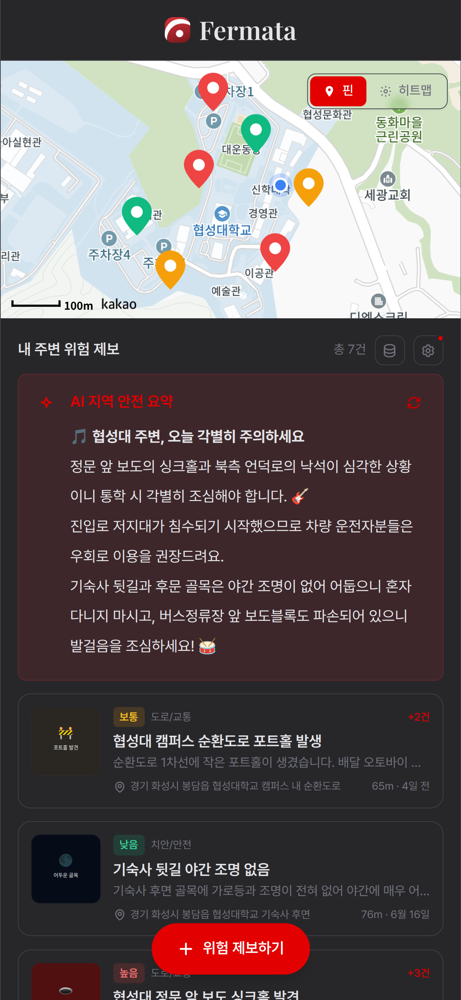
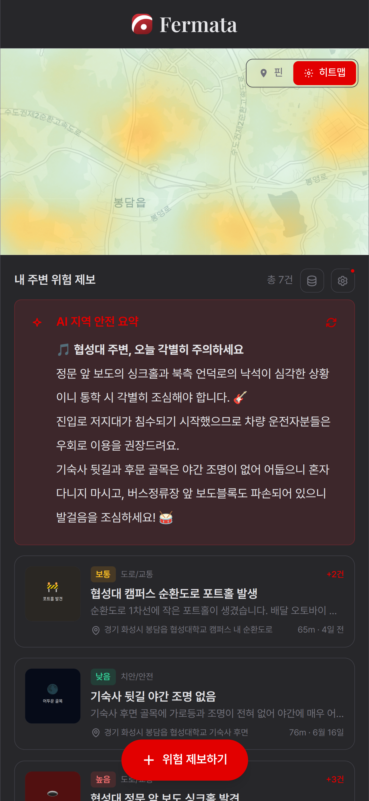
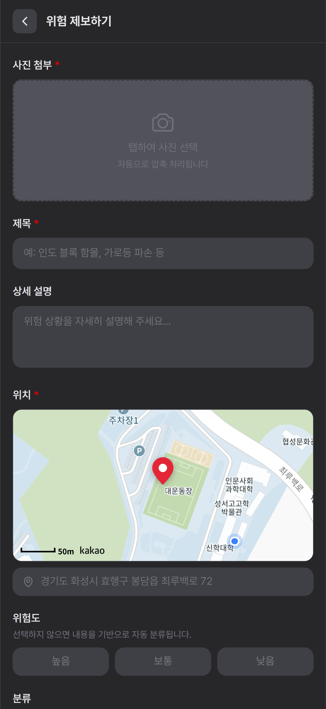
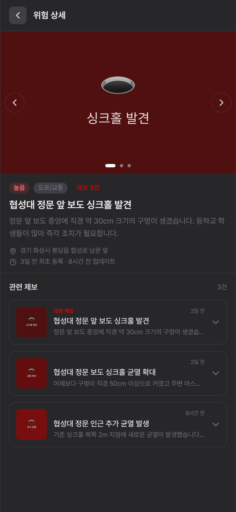

# Fermata — 지역 위험요인 분석 및 예방 플랫폼

> 시민이 직접 잠재 위험요인을 제보하고, AI가 자동으로 분류·군집화하는 커뮤니티형 안전 신고 플랫폼

**배포 주소**: https://myhappydays.github.io/2026_HS_Hackathon/


---

## 스크린샷

| 메인 (핀 뷰) | 히트맵 뷰 | 제보 등록 | 위험 상세 |
|:---:|:---:|:---:|:---:|
|  |  |  |  |

---

## 개요

도로 싱크홀, 침수, 가로등 고장, 낙석 등 지역 내 안전 위협을 시민이 직접 제보할 수 있는 웹앱입니다.
기존 국민 신문고와의 차별점은 **커뮤니티**와 **AI 자동화**입니다.

- 동일한 위험을 여러 명이 제보하면 **하나의 군집으로 자동 통합**
- 제보 텍스트를 AI가 읽고 **위험도·분야를 자동 분류**
- 지도에서 내 주변 위험을 **한눈에 파악**
- AWS Bedrock Claude가 주변 위험 현황을 **자연어로 요약**

---

## 주요 기능

### 지도 뷰

- **카카오 지도**: 위험도별 색상 핀(빨강/주황/초록), 마커 클러스터링
- **히트맵 뷰**: Leaflet.heat + 펄린 노이즈 기반 위험 분포 시각화 (핀 뷰와 토글 전환)
- 현재 위치 표시 (파란 점)

### 제보 등록

- 사진 첨부 (Canvas 자동 압축 — 최대 800×800px WebP, 150KB 초과 시 재압축)
- 지도 중앙 고정 핀으로 위치 지정 → 카카오 역지오코딩으로 주소 자동 입력
- Clef-flash가 위험도·분야를 제안하며, 사용자가 확인 후 등록 (분류 불가 또는 서비스 오류 시 직접 선택 필요)

### 동일 민원 군집화

새 제보 등록 시 기존 군집과 자동 비교하여 같은 사건이면 통합, 다른 사건이면 신규 군집 생성.

| 단계 | 방법 |
|---|---|
| 1차 필터 | Haversine 거리 200m 이내 후보 추림 |
| 2차 판단 | 다국어 문장 임베딩 코사인 유사도 ≥ 0.45 |
| 벡터 갱신 | 배정 시 (기존 + 신규) / 2 평균 갱신 |

- 임베딩 모델: `Xenova/paraphrase-multilingual-MiniLM-L12-v2` (~117MB, WASM, 브라우저 캐시)
- TF-IDF 대비 정확도 +8.5%p (130개 테스트케이스 기준, 63.8% → 72.3%)

### AI 지역 안전 요약 (AWS Bedrock)

메인 페이지 설정 모달에서 Bedrock Bearer 토큰 입력 시 활성화됩니다.

- 내 주변 군집 목록을 Claude에 전달 → 자연어 위험 요약 생성
- 요약 결과 30분 캐시 (불필요한 API 호출 방지)
- 토큰 미설정 시 기능 전체 숨김 (graceful degradation)
- 지원 모델: Claude Haiku 4.5 / Sonnet 4.6 / Opus 4.6

### 안전 카드 공유

- 지도 중심 반경 3.5km의 진행 중인 제보 또는 개별 제보를 카드로 표시합니다. 숫자 위험 지수 대신 제보 건수와 등록된 위험도를 보여 줍니다.
- 지역 카드와 개별 제보 카드에 동일한 화이트·크림슨 디자인을 사용하며, 카드 폭을 공유 버튼 영역에 맞춥니다. 생성 시각과 디자인은 PNG에도 적용됩니다.
- 카드의 AI 요약은 현재 카드의 제보로 별도 생성합니다. Bedrock 토큰이 없거나 요청이 실패하면 그 상태를 명시하며, 확인되지 않은 고정 요약을 표시하지 않습니다. AI 요약에는 별도 호출 비용이 발생할 수 있습니다.
- PNG 저장과 파일 공유를 지원합니다. 파일 공유가 불가능하면 페이지 링크만 공유하거나 복사하며, 이 경우 이미지가 포함되지 않았음을 알립니다.

---

## 기술 스택

| 분류 | 내용 |
|---|---|
| 프레임워크 | 바닐라 JS + Preline UI 2.7.0 |
| 번들러 | Vite 8 (MPA 모드) |
| 스타일 | Tailwind CSS v3 (Play CDN) |
| 지도 | 카카오 지도 SDK (services, clusterer) |
| 히트맵 | Leaflet 1.9.4 + Leaflet.heat 0.2.0 |
| 임베딩 | `@huggingface/transformers` v4 (WASM) |
| AI 요약 | AWS Bedrock Claude API (클라이언트 직접 호출) |
| 저장소 | localStorage (서버 없음) |
| 배포 | GitHub Pages |

---

## 시작하기

### 권장 환경

배포된 사이트(`https://myhappydays.github.io/2026_HS_Hackathon/`)를 **Chrome 또는 Edge**에서 바로 사용하는 것을 권장합니다.

> **로컬 실행 시 주의**: `dist/`를 `file://`로 직접 열면 ES 모듈 CORS 정책으로 JS가 전혀 실행되지 않습니다. 반드시 개발 서버(`npm run dev`) 또는 HTTP 서버를 통해 열어야 합니다.

### 로컬 개발 서버 실행

```bash
npm install
npm run dev
```

기본 주소: `http://localhost:5173/2026_HS_Hackathon/`

### Clef-flash 분류 Worker 설정 및 배포

`worker/`에는 위험도와 분야를 한 번의 Workers AI 호출로 분류하는 v4 프롬프트 및 Cloudflare Worker 설정이 있습니다. 앱의 기본 분류 URL은 `https://fermata-report-clef-v4.hejoliv.workers.dev`이며, 배포 전에는 해당 Worker를 사용할 수 없습니다. 기존 `fermata-category-clef` Worker와는 별도입니다. 필요하면 앱 빌드 시 `VITE_CATEGORY_API_URL`로 다른 `/classify` 엔드포인트를 지정할 수 있습니다.

Cloudflare 계정에 Wrangler를 로그인하고 Workers AI 사용 권한을 준비한 뒤 프로젝트 루트에서 실행합니다. `worker/wrangler.jsonc`의 AI 바인딩과 분당 60회(Cloudflare 위치별) 제한이 함께 배포됩니다.

```bash
cd worker
npm ci
npm run deploy
```

`POST /classify`는 `title`, `description`, 선택적인 `needs` 배열(`danger`, `category`)을 받습니다. `needs`를 생략하면 기존 클라이언트처럼 분야만 분류하고 `category`, `confidence`, `probabilities`를 반환합니다. 요청한 필드의 결과는 `decisions`에도 포함되며 `unknown`이거나 서비스 오류인 경우 직접 선택해야 합니다. `POST /classify-relief`도 기존 형식으로 유지됩니다. 허용 Origin만 CORS를 지원하지만 CORS는 인증이 아니므로 공개 엔드포인트 사용량을 모니터링해야 합니다.

#### 카카오 지도 API 키 교체 (로컬에서 지도가 안 뜰 경우)

카카오 지도 SDK는 **등록된 도메인에서만 동작**합니다. `localhost`에서 실행하려면 직접 키를 발급받아야 합니다.

1. [카카오 개발자 콘솔](https://developers.kakao.com) → 내 애플리케이션 → 앱 생성
2. **플랫폼 → Web** 탭 → 사이트 도메인에 `http://localhost:5173` 추가
3. **앱 키 → JavaScript 키** 복사
4. `index.html`과 `report.html`의 카카오 SDK 스크립트 태그에서 `appkey` 값 교체:

```html
<!-- index.html, report.html 하단 -->
<script src="//dapi.kakao.com/v2/maps/sdk.js?appkey=여기에_발급받은_키&libraries=services,clusterer,visualization"></script>
```

### 빌드

```bash
npm run build   # dist/ 생성
npm run preview # 빌드 결과물 로컬 미리보기
```

`vite.config.js`의 `base: '/2026_HS_Hackathon/'`이 GitHub Pages 경로에 맞게 설정되어 있습니다.

### AI 요약 기능 사용

1. 메인 페이지 리스트 헤더 우측 기어 아이콘 클릭
2. AWS Bedrock Bearer 토큰 입력 (AWS 콘솔 → IAM → 임시 자격 증명 또는 액세스 키 기반 Bearer 토큰)
3. 모델·취합 기준 설정 후 **저장하고 요약 시작** 클릭

토큰은 이 기기의 localStorage에만 저장되며 외부 서버로 전송되지 않습니다.

### 데모 데이터 주입

메인 페이지 리스트 헤더의 **DB 아이콘** 버튼 클릭 → 협성대학교 기준 7개 군집, 15개 제보 자동 생성

---

## 프로젝트 구조

```
src/
├── main.js           # 메인 페이지 — 지도, 리스트, AI 요약 연동
├── report.js         # 제보 등록 — 폼, 이미지 압축, 위치, 군집 배정
├── detail.js         # 상세 페이지 — 군집 정보, 관련 제보 리스트
├── storage.js        # localStorage 읽기/쓰기
├── clustering.js     # Haversine 거리, 코사인 유사도, 군집 배정
├── report.js         # 제보 등록 및 Clef-flash 위험도/분야 제안
├── embedder.js       # 문장 임베딩 모델 싱글톤
├── bedrock.js        # AWS Bedrock Claude 호출, 설정값 관리
└── utils.js          # 시간 포맷, 거리 포맷, 이미지 압축
```

### 페이지 라우팅

| 페이지 | 파일 | 설명 |
|---|---|---|
| 메인 | `index.html` | 지도 뷰 + 군집 리스트 + AI 요약 |
| 제보 등록 | `report.html` | 제보 작성 폼 |
| 상세 | `detail.html?id=클러스터ID` | 군집 상세 + 소속 제보 리스트 |

### localStorage 키 구조

| 키 | 설명 |
|---|---|
| `reports` | 전체 제보 목록 (`Report[]`) |
| `clusters` | 전체 군집 목록 (`Cluster[]`) |
| `bedrock_token` | Bedrock Bearer 토큰 |
| `bedrock_model` | 선택된 모델 ID |
| `bedrock_sort` / `bedrock_max_dist` / `bedrock_max_count` / `bedrock_min_reports` | AI 취합 기준 설정값 |
| `bedrock_summary_cache` | AI 요약 캐시 (30분 TTL) |

---

## 알려진 제한사항

| 항목 | 내용 |
|---|---|
| `file://` 직접 실행 불가 | ES 모듈 CORS 정책으로 JS 실행 안 됨. 반드시 HTTP 서버 필요 |
| 카카오 지도 도메인 제한 | 등록되지 않은 도메인에서는 지도 로드 실패 |
| 군집 위치 고정 | 신규 제보 추가 시 centroid 재계산 없이 최초 생성 위치 유지 |
| 제보/군집 삭제 UI 없음 | localStorage 직접 조작 또는 브라우저 초기화 필요 |
| 기기 간 동기화 없음 | 데이터는 각 기기의 localStorage에만 존재 |
| 임베딩 모델 첫 로드 | 최초 방문 시 ~117MB 다운로드 (이후 브라우저 캐시) |
| Tailwind Play CDN | 프로덕션 비권장. 빌드 최적화 미적용 |

---

## 유사 서비스 대비 차별점

| 기능 | 국민 안전 신문고 | 당근 커뮤니티 | Fermata |
|---|:---:|:---:|:---:|
| 안전 특화 제보 | O | X | O |
| 지도 기반 위험 현황 | 제한적 | X | O |
| 동일 사건 자동 군집화 | X | X | O |
| 시민 간 커뮤니티 | X | O | O |
| 위험도/분야 자동 분류 | X | X | O |
| 서버 없이 동작 | X | X | O |
| AI 지역 안전 요약 | X | X | O |
